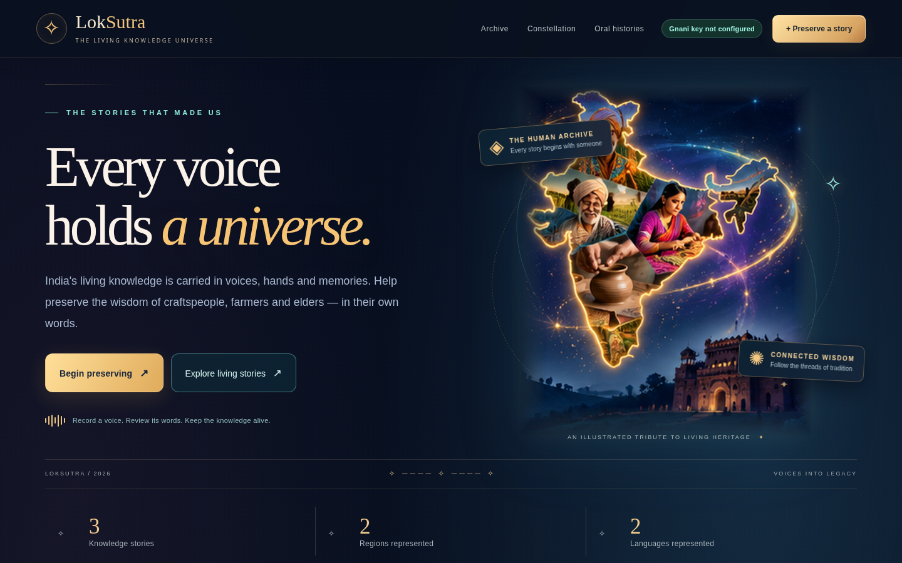

# ✧ LokSutra — India's Living Knowledge Universe

**A human-centered oral-heritage preservation prototype powered by FastAPI, SQLite, and optional Gnani speech-to-text.**

> **One-sentence pitch:** LokSutra helps preserve traditional knowledge in the words of the people who hold it, then turns reviewed transcripts into searchable, source-traceable knowledge chapters.



## The problem

India's traditional craft, farming and community knowledge is often taught orally. When a knowledgeable person stops practising, moves away or passes on, practical knowledge can be lost. Recording a voice is an important first step, but a recording by itself is difficult to search, correct, credit and connect to other records.

## Our solution

**Speak → Transcribe → Review → Preserve → Explore**

1. An **owner** signs in and uploads a recording with the contributor's permission. Supported short recordings can be sent to **Gnani STT** using a backend-held API key.
2. The owner **reads and corrects the transcript** before publishing. Unconfirmed transcription cannot silently overwrite edits.
3. The story is saved in **SQLite** with contributor, region, language, category and tags. Visitors can search and browse the archive.
4. Each chapter displays sentence-level reading steps. **Source Lens** highlights the exact saved sentence behind the selected step (not a fabricated audio timestamp).
5. The **Knowledge Constellation** displays explicit metadata relationships. It does **not** invent historical links or claim semantic AI inference.
6. A **separate, default-off Batch studio** supports asynchronous long-audio workflows with persisted job state and explicit import. A live paid Batch request has **not** been verified in this edition.

### Why LokSutra is different

| Feature | Why it matters | How it works today |
| --- | --- | --- |
| Voice-first preservation | The source of knowledge stays central | Audio upload → optional Gnani REST transcription → editable text |
| Human editorial control | Cultural accuracy is more important than automatic output | Contributor consent, owner login, review before save |
| Source Lens | Learning steps stay linked to the record | Sentence selection highlights exact text in the saved transcript |
| Explainable relationships | Avoids false claims about culture | Graph edges describe shared explicit categories / tags / metadata, not causal history |
| Recoverable Batch jobs | Longer oral histories need interruptions and retries handled carefully | SQLite job state; upload, start, refresh, cancel, explicit import; disabled until approved |
| Honest provenance | Demonstration content must not masquerade as verified fieldwork | Seed examples labelled illustrative; saved owner contributions remain unverified until externally checked |

## Try the demo (judges / reviewers)

The **public archive** can be explored without an owner password. It opens with **illustrative sample entries**, not verified field recordings. The redesigned homepage illustrates India's living heritage; its visual subjects are **AI-generated artwork**, not photographed contributors.

Suggested **90-second tour**:

1. Start LokSutra, point out the living-heritage landing screen and actual archive counts.
2. Open the **Archive**, filter by craft/farming, select a story and read its contributor, region and language.
3. Select a **learning step**. Watch **Source Lens** highlight the matching saved transcript sentence.
4. Open the **Constellation** and inspect a stated reason for a relationship.
5. Explain the owner flow: **consented audio → private Gnani request (when configured and approved) → human correction → SQLite record**. Show a real transcription only if you have personally tested it; never present simulated text as a live API result.

See [DEMO_STORYBOARD.md](DEMO_STORYBOARD.md) for narration ideas and [JUDGES_README.md](JUDGES_README.md) for evaluation notes and a test-status matrix.

## Run it on Windows 11

**Fastest option:** Double-click **`Set Owner Password.cmd`** to create your local owner password, then double-click **`Start LokSutra.cmd`**. The scripts set up a local virtual environment and start FastAPI. Open **http://127.0.0.1:8000** in your browser.

Manual PowerShell setup from the extracted `LokSutra` folder:

```powershell
py -3 -m venv .venv
.\.venv\Scripts\python.exe -m pip install -r requirements.txt
if (-not (Test-Path .env)) { Copy-Item .env.example .env }
.\.venv\Scripts\python.exe setup_owner.py --gui
.\.venv\Scripts\python.exe -m uvicorn main:app --host 127.0.0.1 --port 8000 --no-proxy-headers
```

**For a full Gnani audio test:** Install `ffprobe` from the [FFmpeg project](https://ffmpeg.org/download.html), add it to `PATH` or configure `FFPROBE_PATH` in your private `.env`. The **source-only ZIP does not bundle FFmpeg binaries**. If updating an existing LokSutra folder that already has `tools/ffprobe.exe`, keep that folder. Record **consented** audio; confirm account access and pricing before any real API call.

Put your Gnani API key only in your local `.env`:

```dotenv
GNANI_API_KEY=replace_with_your_private_key
```

The `.env` file is **not included in downloadable packages**, and the browser does not receive the key. Your owner password is separate. See [PASSWORD_SETUP.md](PASSWORD_SETUP.md), [LONG_AUDIO.md](LONG_AUDIO.md) and [TECHNICAL_REFERENCE.md](TECHNICAL_REFERENCE.md) for setup and security details.

## Stack and architecture

| Layer | Technology | Role |
| --- | --- | --- |
| Frontend | HTML, CSS, vanilla JavaScript | Cinematic landing, accessible browsing, editing, constellation |
| API | Python + FastAPI | Validates owner access and audio; provides search, save, auth and Gnani adapter |
| Database | SQLite | Stories, ownership/session state, idempotency records, Batch job metadata |
| Speech service | Gnani STT REST / optional Gnani Batch | Provider transcription; never simulated as successful |
| Tests | Pytest, Playwright/Chromium, Node test runner | Backend contracts, interface behaviour, integration checks with mocked providers |

All front-end illustration files are local. The site does not require a third-party image server. `main.py` serves only the `frontend/` directory at the web root, so `.env` is not made accessible as a static file.

## Reproducing the automated checks

```powershell
.\.venv\Scripts\python.exe -m pip install -r requirements-dev.txt
.\.venv\Scripts\python.exe -m pytest -q
node --check frontend/app.js
node --check frontend/experience.js
node --check frontend/batch.js
node --test tests/frontend_config.test.cjs
```

Browser tests need a local Chrome/Chromium installation. Audio validation tests require `ffprobe` and may skip when unavailable. Automated Gnani tests **mock** provider responses and do not spend provider credits. Full details and known test-environment conditions are in [TEST_REPORT.md](TEST_REPORT.md) and [VERIFICATION.md](VERIFICATION.md).

## Important boundaries / honest project status

- **Real Gnani API live test:** not performed as part of this visual upgrade. A key being present means **configured, not verified**. To run a single approved short-audio smoke test, use `live_smoke.py`; it requests explicit permission before transmission.
- **Gnani Batch:** coded and tested with mocked provider responses; **default disabled** and live billed processing **not verified**. Job cancellation is best-effort according to provider support.
- **Learning steps:** sentence-based from owner-saved text; not an LLM-generated curriculum or factual verification.
- **Knowledge graph:** relationships from explicit metadata; not a discovered semantic or historical truth.
- **Audio archive:** the current short-recording workflow does not permanently store uploaded source audio; the saved transcript is the preserved artifact.
- **Owner access:** one owner login; no public contributions, user accounts or moderation queue.
- **Production:** no production deployment, security audit, or guarantee of internship selection. Do not publicly expose the development server.
- **Sample data:** illustrative and not independently authenticated. Obtain consent and verify cultural accuracy before publication.

## Hand-off and submission

The source-only package can be recreated using:

```powershell
.\.venv\Scripts\python.exe package_submission.py
```

It deliberately excludes **`.env`, local SQLite databases, recordings, `.venv`, and tools**. Complete the real contributor/team information in [SUBMISSION.md](SUBMISSION.md) before submitting. Do not imply that a LinkedIn post alone completes the challenge submission; follow the organizers' actual instructions.

**More documentation:** [Judge briefing](JUDGES_README.md) · [Architecture / security](TECHNICAL_REFERENCE.md) · [Long-audio boundaries](LONG_AUDIO.md) · [Demo storyboard](DEMO_STORYBOARD.md) · [Testing](TEST_REPORT.md).
